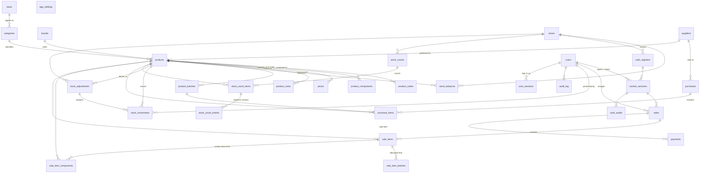

# 02. Data Model

## 1. Purpose & Conventions

This document defines the authoritative relational model for **Elman-U POS**. It is the single source of truth from which PostgreSQL migrations (DDL) will be generated 1:1.

**Naming convention:** English lowercase, `snake_case` for identifiers. Tables are plural nouns; foreign keys use the referenced table's singular + `_id`.

**Type conventions:**
| Domain | Type | Rationale |
|---|---|---|
| Money | `NUMERIC(12,2)` | Arbitrary precision, satisfies **BR-01**. Floating point is prohibited. |
| Quantity / weight | `NUMERIC(12,3)` | Supports kg / liter / fractional units (0.300 kg of cold cuts). |
| Timestamps | `TIMESTAMPTZ` | UTC storage, avoids timezone ambiguity. The web shows them in the store's time zone (`STORE_TIMEZONE`, default `America/Argentina/Buenos_Aires`). |
| Primary keys | `BIGSERIAL` | Sequential surrogate keys (except `stock_balances`, see §4.7). |
| Status / fixed vocabulary | `ENUM` (PostgreSQL) | Enforces allowed values at engine level (**NFR-02**). |

**Design pillars** (each maps to a business rule from `01-domain-and-requirements.md`):
- **P-01 — Immutable ledger:** All inventory change flows exclusively through `stock_movements` (append-only, no `UPDATE`/`DELETE`). `stock_balances` is a cached, transactionally-maintained aggregate (**BR-05**).
- **P-02 — Price/cost snapshot:** `sale_items` copies `unit_price` and `unit_cost` at sale time; price/cost history lives in dedicated tables with `valid_from` (**BR-03**).
- **P-03 — Atomicity:** Sale, purchase, and count-confirmation each execute inside one `BEGIN...COMMIT` transaction, updating balances and inserting movements atomically (**BR-04**).
- **P-04 — FIFO lot allocation:** Lot-controlled products consume stock from the oldest remaining batch; one sale line may span multiple batches via `sale_item_batches`.

---

## 2. Entity Relationship Overview



---

## 3. Enumerations (PostgreSQL `ENUM`)

```sql
CREATE TYPE product_sale_type    AS ENUM ('UNIT', 'WEIGHT', 'COMPOSITE');
CREATE TYPE product_code_type    AS ENUM ('EAN13', 'EAN8', 'INTERNAL');
CREATE TYPE movement_type        AS ENUM ('SALE', 'PURCHASE', 'RETURN', 'ADJUSTMENT', 'EXPIRATION', 'TRANSFER');
CREATE TYPE adjustment_reason    AS ENUM ('COUNT', 'OWN_CONSUMPTION', 'DAMAGE', 'EXPIRATION', 'THEFT', 'OTHER');
CREATE TYPE payment_method       AS ENUM ('CASH', 'DEBIT_CARD', 'CREDIT_CARD', 'TRANSFER', 'QR');
CREATE TYPE user_role            AS ENUM ('ADMIN', 'CASHIER', 'STOCK_CLERK');
CREATE TYPE sale_status          AS ENUM ('COMPLETED', 'VOIDED');
CREATE TYPE session_status       AS ENUM ('OPEN', 'CLOSED');
CREATE TYPE count_status         AS ENUM ('DRAFT', 'CONFIRMED');
CREATE TYPE purchase_status      AS ENUM ('RECEIVED', 'VOIDED');
CREATE TYPE measure_unit         AS ENUM ('UNIT', 'GRAM', 'KILOGRAM', 'LITER', 'MILLILITER', 'METER');
```

Semantics:
- `product_sale_type`:
  - `UNIT` — sold by whole or fractional unit count (2 bread rolls → `quantity = 2`).
  - `WEIGHT` — sold by weight; PVP is per kg (mortadella, bakery bread); `quantity` is in kg.
  - `COMPOSITE` — a kit/pack (seasonal candy box); selling it decrements component stock via `product_components`.
- `movement_type`: physical direction of the ledger entry. `ADJUSTMENT` covers manual corrections and count reconciliation (see §7).

---

## 4. Tables

### 4.1 `taxes`

| Column | Type | Constraints | Description |
|---|---|---|---|
| id | BIGSERIAL | PK | |
| name | VARCHAR(80) | NOT NULL | e.g. `IVA 21%` |
| rate | NUMERIC(5,2) | NOT NULL, CHECK (rate >= 0 AND rate <= 100) | Percentage (0, 10.5, 21, 27). |
| is_active | BOOLEAN | NOT NULL DEFAULT TRUE | Soft delete / disable. |
| created_at | TIMESTAMPTZ | NOT NULL DEFAULT now() | |
| updated_at | TIMESTAMPTZ | NOT NULL DEFAULT now() | |
| (index) | | UNIQUE INDEX `idx_taxes_name_unique_lower` on `LOWER(name)` | Case-insensitive unique name |

### 4.2 `categories`

| Column | Type | Constraints | Description |
|---|---|---|---|
| id | BIGSERIAL | PK | |
| parent_id | BIGINT | FK → categories.id, NULL, CHECK (parent_id <> id) | Tree hierarchy (self-reference). NULL = root. |
| name | VARCHAR(120) | NOT NULL | e.g. `Almacén` → `Galletitas` |
| tax_id | BIGINT | FK → taxes.id, NOT NULL | IVA rate inherited by products in this category (its own, not the parent's). When creating a subcategory, the UI pre-fills the parent's rate. |
| is_active | BOOLEAN | NOT NULL DEFAULT TRUE | Soft delete / disable. |
| created_at | TIMESTAMPTZ | NOT NULL DEFAULT now() | |
| updated_at | TIMESTAMPTZ | NOT NULL DEFAULT now() | |
| (index) | | UNIQUE INDEX `idx_categories_parent_name_unique_lower` on `(parent_id, LOWER(name)) NULLS NOT DISTINCT` | Case-insensitive name, unique among siblings (root categories included). |

Index: `(parent_id)`.

> **Tree integrity:** longer cycles (A → B → A) cannot be expressed as a `CHECK`; the application rejects them on update. A category cannot be deactivated while it has active children, nor reactivated while its parent is inactive.

### 4.3 `brands`

| Column | Type | Constraints | Description |
|---|---|---|---|
| id | BIGSERIAL | PK | |
| name | VARCHAR(120) | NOT NULL, UNIQUE | |
| is_active | BOOLEAN | NOT NULL DEFAULT TRUE | Soft delete / disable. |
| created_at | TIMESTAMPTZ | NOT NULL DEFAULT now() | |
| updated_at | TIMESTAMPTZ | NOT NULL DEFAULT now() | |

> Names are stored uppercased and tidied (`model.Brand.Validate`), so `UNIQUE(name)` also catches "coca  cola" vs "COCA COLA". `BrandStore.GetByName` looks one up by exact name (the product create uses it before creating a new brand, F-01).

### 4.4 `products`

| Column | Type | Constraints | Description |
|---|---|---|---|
| id | BIGSERIAL | PK | |
| sku | VARCHAR(40) | NOT NULL, UNIQUE, DEFAULT `next_product_sku()` | Internal code. **Generated by the DB** when left empty: `000123` from the sequence `products_sku_seq` (migration `0010`); the width grows past 6 digits instead of cutting. The UI never asks for it (shown read-only on edit); the API may still send one. Stored trimmed and uppercased, since `UNIQUE` is case-sensitive. It is **not** the barcode: barcodes live in `product_codes` (§4.5). |
| name | VARCHAR(200) | NOT NULL | Commercial name. Stored uppercased (like `brands`, matching the source dataset). Not unique: two products may share a name with different `sku`. |
| description | VARCHAR(500) | NULL | Short description. |
| brand_id | BIGINT | FK → brands.id, NULL | |
| category_id | BIGINT | FK → categories.id, NOT NULL | Inherits default tax from category. |
| measure_unit | measure_unit | NOT NULL DEFAULT 'UNIT' | |
| sale_type | product_sale_type | NOT NULL DEFAULT 'UNIT' | See §3. `WEIGHT` requires `measure_unit = 'KILOGRAM'` (price and quantity are per kg, F-10); enforced by the app. |
| controls_batches | BOOLEAN | NOT NULL DEFAULT FALSE | When TRUE, stock is tracked per batch (FIFO + expiry). Always FALSE for `COMPOSITE`: a pack has no stock of its own, its components track their batches (§4.6). |
| reorder_point | NUMERIC(12,3) | NOT NULL DEFAULT 0, CHECK (reorder_point >= 0) | Reorder threshold: when `stock_balances.quantity <= reorder_point`, the product appears in the replenishment report. Expressed in the product's stock unit (count or kg). |
| max_stock | NUMERIC(12,3) | NULL, CHECK (max_stock IS NULL OR max_stock > reorder_point) | Ceiling to avoid overstocking; upper bound for suggested order quantities. |
| margin_percent | NUMERIC(5,2) | NOT NULL DEFAULT 0, CHECK (margin_percent >= 0) | Target gross margin (%). Over the price without IVA. PVP suggestion when unit cost changes: `pvp_suggested = unit_cost × (1 + tax_rate/100) / (1 - margin_percent/100)`, with the category's IVA rate (costs are net, prices include IVA; F-04). `0` = no automatic suggestion. The app also requires `margin_percent < 100` (at 100 the formula divides by zero). |
| preferred_supplier_id | BIGINT | FK → suppliers.id, NULL | Preferred supplier; the replenishment report shows who to contact. |
| shelf_life_days | INTEGER | NULL, CHECK (BETWEEN 1 AND 3650) | How many days it usually lasts from reception (migration `0014`). Purchase reception prefills a batch's expiry with today + these days (F-06). `NULL` = unknown, no prefill. Per product, not per category: one category mixes things that last 7 and 30 days. |
| open_price | BOOLEAN | NOT NULL DEFAULT FALSE | Unregistered item (migration `0022`): the register types the price on each line and the sale moves no stock. Set by the admin, only on products by unit without batches (F-07). |
| is_consignment | BOOLEAN | NOT NULL DEFAULT FALSE | Consigned product (owned by supplier until sold). |
| is_active | BOOLEAN | NOT NULL DEFAULT TRUE | Soft delete / disable. |
| created_at | TIMESTAMPTZ | NOT NULL DEFAULT now() | |
| updated_at | TIMESTAMPTZ | NOT NULL DEFAULT now() | |

Indexes: `(category_id)`, `(brand_id)`, `(is_active)`; for the large catalog (migration `0011`, see `architecture.md` D-05): `(is_active DESC, name, sku)` for the admin list order, and `pg_trgm` GIN on `name` and `sku` for "contains" search.

> **Generated sku and concurrency:** a `SEQUENCE` never hands out the same number twice, even for two products created at the same moment (`MAX(sku) + 1` would). A failed `INSERT` leaves a gap; the sku only has to be unique. Sequences ignore `ROLLBACK`. When importing a catalog, the sequence must be moved past the highest numeric sku (`setval`), see `db/import/`.

> **Validated by the app, not the DB:** the `WEIGHT`/`KILOGRAM`, `COMPOSITE`/no-batches and `margin_percent < 100` rules above live in `model.Product.Validate()`; quantities are also limited to 3 decimals and the margin to 2 (Postgres would round silently).

> **Reorder semantics:** the alert is not stored — it is computed at query time: `products.is_active = TRUE AND stock_balances.quantity <= reorder_point`, only for products with `reorder_point > 0` (the imported catalog starts at 0; those show in R-01's "ran out" section only when they sold and have no stock). The report (ordering, suggested order size capped by `max_stock`) is defined in `03-flows-and-transactions.md`.

### 4.5 `product_codes`

| Column | Type | Constraints | Description |
|---|---|---|---|
| id | BIGSERIAL | PK | |
| product_id | BIGINT | FK → products.id ON DELETE CASCADE, NOT NULL | Deleting a product deletes its codes (migration `0012`): a code is not history, sales and movements point to the product. A product with history still cannot be deleted. |
| code_type | product_code_type | NOT NULL | **Derived from the code, never chosen** (`model.BarcodeType`, see below). `INTERNAL` for store-printed pack/scale codes. |
| code | VARCHAR(14) | NOT NULL, UNIQUE, CHECK (`code ~ '^[0-9]{13,14}$'`) | Digits only, **left-padded with zeros to 13** (14 kept for DUN-14). EAN-8 `40170725` is stored `0000040170725`. |
| created_at | TIMESTAMPTZ | NOT NULL DEFAULT now() | |

Supports **multiple barcodes per product** (manufacturer packaging changes, dual EAN-13/8).

> **Normalization (`model.NormalizeBarcode`):** trim spaces (scanners append an Enter), digits only, 1–14 digits, not all zeros, left-pad to 13. A scanned code goes through the same function before any lookup, so `40170725` and `0000040170725` are the same code. The `CHECK` keeps a manual `INSERT` or a future import from storing `9000001` next to `0000009000001`, which `UNIQUE` would see as different.

> **Type (`model.BarcodeType`), the same rule as `db/import/clean_catalog.sql`:** strip the leading zeros; `EAN8` if 8 digits remain and the GS1 check digit is valid; `EAN13` if 12 or more remain (UPC-A included), the check digit is valid and it does not start with `2` (scale / in-store prefix); else `INTERNAL`. Quirk kept on purpose so the catalog and the app agree: an EAN-8 or UPC-A starting with `0` loses that zero and comes out `INTERNAL`. Today the type is only a label; nothing depends on it.

### 4.6 `product_components`

| Column | Type | Constraints | Description |
|---|---|---|---|
| id | BIGSERIAL | PK | |
| pack_id | BIGINT | FK → products.id, NOT NULL | The `COMPOSITE` product. |
| component_id | BIGINT | FK → products.id, NOT NULL | A component whose stock actually moves. |
| quantity | NUMERIC(12,3) | NOT NULL, CHECK (quantity > 0) | Component units consumed per pack sold. |
| created_at | TIMESTAMPTZ | NOT NULL DEFAULT now() | |

CHECK: `pack_id <> component_id`. Index: `(pack_id)`. UNIQUE `(pack_id, component_id)` (migration `0023`): a component appears once per combo; setting it again changes its quantity.
> Selling a pack decrements component stock (BOM semantics); packs have no stock of their own. Example: a pack of cigarettes is 20 loose ones, a bag is 10 candies; only the loose product has stock, and each has its own price.
>
> **Rules (app, `model.CheckComponent`):** the pack is `COMPOSITE`; a component is an active `UNIT` or `WEIGHT` product, never another `COMPOSITE` (no nesting) nor an open-price item (no stock); a `UNIT` component needs a whole quantity, a `WEIGHT` one is in kg with up to 3 decimals. Checked again at every sale, since a component may have been deactivated after the recipe was saved. Only the admin changes a recipe (permission `combos`, F-05).

### 4.7 `prices` & `product_costs` — price/cost history

`prices`:
| Column | Type | Constraints | Description |
|---|---|---|---|
| id | BIGSERIAL | PK | |
| product_id | BIGINT | FK → products.id, NOT NULL | |
| unit_price | NUMERIC(12,2) | NOT NULL, CHECK (unit_price > 0) | PVP. For `WEIGHT` products: price per kg. |
| valid_from | TIMESTAMPTZ | NOT NULL | |
| created_at | TIMESTAMPTZ | NOT NULL DEFAULT now() | |

Constraint: `UNIQUE (product_id, valid_from)` — no overlapping vigencias. Index `(product_id, valid_from DESC)` for "current price".

Rows are only appended (F-03): a new price gets `valid_from = clock_timestamp()` and the current price is the latest `valid_from`. Product reads get it with `LEFT JOIN LATERAL (... ORDER BY valid_from DESC LIMIT 1)`, which Postgres runs only for the rows it returns (measured on the real catalog, 64,602 products with 3 prices each: the 50-row list goes from 0.14 to 0.40 ms). No future prices exist yet, so the reads do not filter `valid_from <= now()`.

`product_costs`:
| Column | Type | Constraints | Description |
|---|---|---|---|
| id | BIGSERIAL | PK | |
| product_id | BIGINT | FK → products.id, NOT NULL | |
| unit_cost | NUMERIC(12,2) | NOT NULL | Last purchase cost. |
| avg_cost | NUMERIC(12,2) | NOT NULL | Weighted average cost. |
| valid_from | TIMESTAMPTZ | NOT NULL | |
| created_at | TIMESTAMPTZ | NOT NULL DEFAULT now() | |

Constraint: `UNIQUE (product_id, valid_from)`. Index `(product_id, valid_from DESC)`.

Rows are only appended (F-04): a new cost gets `valid_from = clock_timestamp()` and the current cost is the latest `valid_from`. `unit_cost` is the last cost (the PVP suggestion uses it); `avg_cost` is computed by the app (`model.AverageCost`) from the current cost and the stock summed over all stores, never typed. The app also requires `unit_cost > 0` (the column has no `CHECK`). Costs normally come from purchase reception (F-06); a manual entry keeps `avg_cost` unless there was no cost or no stock.

> **Rationale (P-02 / BR-03):** costs and prices are historical series, never mutable single columns. Reports value past sales with the cost/price effective at that moment.

---

### 4.8 `stores`

| Column | Type | Constraints | Description |
|---|---|---|---|
| id | BIGSERIAL | PK | |
| name | VARCHAR(120) | NOT NULL | |
| address | VARCHAR(200) | NULL | |
| is_active | BOOLEAN | NOT NULL DEFAULT TRUE | Soft delete / disable. |
| created_at | TIMESTAMPTZ | NOT NULL DEFAULT now() | |
| updated_at | TIMESTAMPTZ | NOT NULL DEFAULT now() | |

### 4.9 `cash_registers`

| Column | Type | Constraints | Description |
|---|---|---|---|
| id | BIGSERIAL | PK | |
| store_id | BIGINT | FK → stores.id, NOT NULL | |
| name | VARCHAR(80) | NOT NULL | Terminal label: `Caja 1`, `Caja 2`. |
| is_active | BOOLEAN | NOT NULL DEFAULT TRUE | Soft delete / disable. |
| created_at | TIMESTAMPTZ | NOT NULL DEFAULT now() | |
| updated_at | TIMESTAMPTZ | NOT NULL DEFAULT now() | |

> A store can host multiple physical terminals; cash session & audit belong to the **register**, not the store.

### 4.10 `suppliers`

| Column | Type | Constraints | Description |
|---|---|---|---|
| id | BIGSERIAL | PK | |
| name | VARCHAR(160) | NOT NULL | |
| tax_id_number | VARCHAR(20) | NULL | CUIT/RUC. |
| phone | VARCHAR(40) | NULL | |
| email | VARCHAR(120) | NULL | |
| payment_terms | VARCHAR(120) | NULL | e.g. `Contado`, `30 días`. |
| is_active | BOOLEAN | NOT NULL DEFAULT TRUE | |
| created_at | TIMESTAMPTZ | NOT NULL DEFAULT now() | |
| updated_at | TIMESTAMPTZ | NOT NULL DEFAULT now() | |

### 4.11 `product_batches`

| Column | Type | Constraints | Description |
|---|---|---|---|
| id | BIGSERIAL | PK | |
| product_id | BIGINT | FK → products.id, NOT NULL | |
| batch_number | VARCHAR(80) | NOT NULL | Printed lot. Within one reception, lines with the same product, number, expiry and cost merge into one row; a different cost is a separate row (F-06). Received without a number → `C-<purchase id>` (automatic batch). Extra stock found by a count → `I-<count id>` (F-09). |
| expiry_date | DATE | NULL | NULL allowed for non-perishable batches. |
| original_quantity | NUMERIC(12,3) | NOT NULL, CHECK (> 0) | Received quantity. Immutable. |
| remaining_quantity | NUMERIC(12,3) | NOT NULL | Decremented on each FIFO allocation. |
| unit_cost | NUMERIC(12,2) | NOT NULL | Cost per unit/kg at reception (basis for exact CMV). |
| is_consumed | BOOLEAN | NOT NULL DEFAULT FALSE | Set TRUE when `remaining_quantity = 0`; excluded from FIFO. |
| created_at | TIMESTAMPTZ | NOT NULL DEFAULT now() | |
| updated_at | TIMESTAMPTZ | NOT NULL DEFAULT now() | |

CHECK: `remaining_quantity >= 0 AND remaining_quantity <= original_quantity`.

Indexes: `(product_id, remaining_quantity, expiry_date)` — FIFO scan picks oldest remaining batch first.

> **Why `unit_cost` on the batch:** week-to-week price variation must flow to COGS. A sale allocated from a batch inherits that batch's cost, making margins truthful (**P-04**).

---

### 4.12 `stock_movements` — the immutable ledger (P-01 / BR-05)

| Column | Type | Constraints | Description |
|---|---|---|---|
| id | BIGSERIAL | PK | |
| product_id | BIGINT | FK → products.id, NOT NULL | |
| store_id | BIGINT | FK → stores.id, NOT NULL | |
| batch_id | BIGINT | FK → product_batches.id, NULL | Which lot this movement touched (expiration, damage, FIFO sale). |
| movement_type | movement_type | NOT NULL | |
| reason | adjustment_reason | NULL | Required when `movement_type = 'ADJUSTMENT'`. |
| quantity | NUMERIC(12,3) | NOT NULL, CHECK (quantity <> 0) | Signed. Inbound positive, outbound negative. |
| unit_cost | NUMERIC(12,2) | NOT NULL | Cost snapshot at movement time (valuation). |
| sale_id | BIGINT | FK → sales.id, NULL | |
| purchase_id | BIGINT | FK → purchases.id, NULL | |
| count_id | BIGINT | FK → stock_counts.id, NULL | |
| adjustment_id | BIGINT | FK → stock_adjustments.id, NULL | Known exit (F-09b, migration `0016`). |
| performed_by | BIGINT | FK → users.id, NULL | Who made the movement: who sold, voided, received, confirmed the count or wrote the exit (F-13). `NULL` only in rows from before the login. (migration `0013` made it nullable). |
| notes | VARCHAR(500) | NULL | Free-text context. |
| created_at | TIMESTAMPTZ | NOT NULL DEFAULT now() | |

Constraints:
- **Exactly one source reference:** `CHECK (num_nonnulls(sale_id, purchase_id, count_id, adjustment_id) = 1)` — no polymorphic FK (`adjustment_id` since `0016`).
- **A known exit only takes stock out:** `CHECK (adjustment_id IS NULL OR (movement_type = 'ADJUSTMENT' AND quantity < 0))`.
- **Sign per type:**
  ```sql
  CHECK (
    (movement_type IN ('PURCHASE', 'RETURN') AND quantity > 0)
    OR (movement_type = 'ADJUSTMENT')  -- sign depends on direction
    OR (movement_type IN ('SALE', 'EXPIRATION', 'TRANSFER') AND quantity < 0)
  )
  ```

Indexes: `(product_id, created_at)`, `(batch_id)`, `(store_id, created_at)`, `(movement_type)`.

> **Append-only:** application never `UPDATE`s or `DELETE`s this table. Every stock change is a row; `stock_balances` is derived + cached.

### 4.13 `stock_balances` — cached aggregate

| Column | Type | Constraints | Description |
|---|---|---|---|
| product_id | BIGINT | FK → products.id, NOT NULL | |
| store_id | BIGINT | FK → stores.id, NOT NULL | |
| quantity | NUMERIC(12,3) | NOT NULL, CHECK (>= 0) | Current physical stock. Never negative. |
| created_at | TIMESTAMPTZ | NOT NULL DEFAULT now() | |
| updated_at | TIMESTAMPTZ | NOT NULL | |

**Primary key: `(product_id, store_id)`** — one row per product per store, duplicates impossible at engine level.
Adding uses `INSERT ... ON CONFLICT DO UPDATE`; subtracting (a count that found less) uses a plain `UPDATE`, because Postgres checks the `CHECK` on the row it tries to insert (the negative quantity) before seeing the conflict.
Maintained inside the same transaction as every `stock_movements` insert (**P-03**).

### 4.14 `stock_counts`, `stock_count_items` & `stock_count_entries` — physical inventory

Also the initial inventory (F-09). Migration `0015` added the sectors, cost and expiry.

`stock_counts`:
| Column | Type | Constraints | Description |
|---|---|---|---|
| id | BIGSERIAL | PK | |
| store_id | BIGINT | FK → stores.id, NOT NULL | |
| status | count_status | NOT NULL DEFAULT 'DRAFT' | |
| created_by | BIGINT | FK → users.id, NULL | Who opened the count (F-13). `NULL` only in rows from before the login. Who confirmed it is the `performed_by` of its movements and the `audit_log.user_id`. |
| created_at | TIMESTAMPTZ | NOT NULL DEFAULT now() | |
| updated_at | TIMESTAMPTZ | NOT NULL DEFAULT now() | |
| confirmed_at | TIMESTAMPTZ | NULL | |

Partial unique index `stock_counts_one_draft_per_store ON (store_id) WHERE status = 'DRAFT'`: one count in progress per store.

`stock_count_items` (one row per counted product):
| Column | Type | Constraints | Description |
|---|---|---|---|
| id | BIGSERIAL | PK | |
| count_id | BIGINT | FK → stock_counts.id ON DELETE CASCADE, NOT NULL | Discarding a draft deletes its items. |
| product_id | BIGINT | FK → products.id, NOT NULL | |
| system_quantity | NUMERIC(12,3) | NOT NULL | Snapshot of the store balance at the product's first load in the count. |
| counted_quantity | NUMERIC(12,3) | NOT NULL, CHECK (>= 0) | Sum of its entries (kept by the app in the same transaction). |
| unit_cost | NUMERIC(12,2) | NULL, CHECK (> 0) | Optional, without IVA: cost of extra stock, enters the average (F-04). |
| expiry_date | DATE | NULL | Optional: expiry of the batch extra stock creates (`controls_batches` only). |
| created_at | TIMESTAMPTZ | NOT NULL DEFAULT now() | |
| updated_at | TIMESTAMPTZ | NOT NULL DEFAULT now() | |

UNIQUE `(count_id, product_id)`.

`stock_count_entries` (one row per load: a product counted in a sector):
| Column | Type | Constraints | Description |
|---|---|---|---|
| id | BIGSERIAL | PK | |
| item_id | BIGINT | FK → stock_count_items.id ON DELETE CASCADE, NOT NULL | |
| sector | VARCHAR(60) | NOT NULL, CHECK (btrim(sector) <> '') | Where it was counted ("Aisle 3", "Storeroom"). |
| quantity | NUMERIC(12,3) | NOT NULL, CHECK (>= 0) | 0 is a valid count. |
| created_at | TIMESTAMPTZ | NOT NULL DEFAULT now() | |

Index `(item_id)`. Removing an item's last entry deletes the item (the product is "not counted" again).

> **Confirmation flow (§7.3, F-09):** `DRAFT` items are loaded/edited freely; on `CONFIRMED`, every item where `counted_quantity <> system_quantity` gets `ADJUSTMENT`/`COUNT` movements with the difference, referenced by `count_id`, and the balance moves by that difference. A confirmed count is never deleted (its movements reference it).

### 4.15 `cashier_sessions`

| Column | Type | Constraints | Description |
|---|---|---|---|
| id | BIGSERIAL | PK | |
| cash_register_id | BIGINT | FK → cash_registers.id, NOT NULL | |
| opened_by | BIGINT | FK → users.id, NULL | Who opened the session (F-13). `NULL` only in rows from before the login. |
| opening_amount | NUMERIC(12,2) | NOT NULL, CHECK (>= 0) | Initial cash float. |
| closing_amount | NUMERIC(12,2) | NULL | Cash **declared** at close (what was counted in the drawer, float included): the `CASH` row of `cash_audits`. Not the expected amount, and not the difference (§4.20). |
| status | session_status | NOT NULL DEFAULT 'OPEN' | |
| opened_at | TIMESTAMPTZ | NOT NULL DEFAULT now() | |
| closed_at | TIMESTAMPTZ | NULL | |
| closed_by | BIGINT | FK → users.id, NULL | Who closed it (F-12, migration `0020`). The register is shared at shift change, so `opened_by` alone does not say it. `NULL` while open and in sessions closed before the login. |

> A sale requires an `OPEN` session (**BR-02**). At most one `OPEN` session per register: the partial unique index `uq_cashier_sessions_one_open` on `(cash_register_id) WHERE status = 'OPEN'` (migration `0017`) rejects a second one even when two screens open the same register at the same time.
>
> Closing (F-12) sets `status = 'CLOSED'`, `closing_amount`, `closed_at` and `closed_by` in the same transaction that writes the `cash_audits` rows. A closed session never reopens, and its sales can no longer be voided (F-08), so its cash audit never changes.

### 4.16 `sales`

| Column | Type | Constraints | Description |
|---|---|---|---|
| id | BIGSERIAL | PK | |
| cashier_session_id | BIGINT | FK → cashier_sessions.id, NOT NULL | |
| sale_number | INTEGER | NOT NULL | Sequential **per register**: it continues from session to session and never repeats (next = highest number of the register's sales + 1, read with the session locked). |
| status | sale_status | NOT NULL DEFAULT 'COMPLETED' | |
| subtotal | NUMERIC(12,2) | NOT NULL, CHECK (>= 0) | `Σ quantity × unit_price`, each line rounded to cents. **IVA included.** |
| tax_amount | NUMERIC(12,2) | NOT NULL, CHECK (>= 0) | The IVA already **inside** `subtotal` (`Σ line_total × rate / (100 + rate)`, summed unrounded and rounded once). Informative: it is not added to the total. |
| discount_amount | NUMERIC(12,2) | NOT NULL DEFAULT 0, CHECK (>= 0) | The cash rounding (migration `0024`): what the cash part lost by rounding down to `cash_rounding_multiple`. The only discount. |
| total | NUMERIC(12,2) | NOT NULL, CHECK (> 0) | `subtotal − discount_amount` (prices include IVA). What was charged: payments add up to it. |
| created_at | TIMESTAMPTZ | NOT NULL DEFAULT now() | |
| updated_at | TIMESTAMPTZ | NOT NULL DEFAULT now() | |
| voided_at | TIMESTAMPTZ | NULL | When the sale was voided (F-08, migration `0018`). |
| void_reason | VARCHAR(300) | NULL | Why it was voided: required, trimmed, up to 300 characters (F-08, migration `0018`). Also kept in `audit_log`. |
| created_by | BIGINT | FK → users.id, NULL | Who charged the sale (F-07, migration `0020`): the session's `opened_by` is not enough when the register changes hands. `NULL` in sales from before the login. Who voided it is in `audit_log` (`VOID`) and in the `performed_by` of the `RETURN` movements, not in a column. |

UNIQUE `(cashier_session_id, sale_number)`. The DB only guards per session; "never repeats per register" is kept by the app (one `OPEN` session per register, and the number is read with that session locked).

`chk_sales_void` (migration `0018`): `status = 'VOIDED'` ⇔ `voided_at IS NOT NULL` ⇔ `void_reason IS NOT NULL`, and the reason is never blank (`btrim(void_reason) <> ''`). A completed sale has neither; a voided one always has both. In a void (F-08) the sale row is updated in place; the stock goes back with new `RETURN` movements (plus the batches' and balances' quantities), and `payments` is not touched.

### 4.17 `sale_items`

| Column | Type | Constraints | Description |
|---|---|---|---|
| id | BIGSERIAL | PK | |
| sale_id | BIGINT | FK → sales.id, NOT NULL | |
| product_id | BIGINT | FK → products.id, NOT NULL | |
| quantity | NUMERIC(12,3) | NOT NULL, CHECK (> 0) | Units or kg. |
| unit_price | NUMERIC(12,2) | NOT NULL, CHECK (> 0) | **Snapshot** (BR-03). |
| unit_cost | NUMERIC(12,2) | NOT NULL | **Snapshot** cost for margin. |
| tax_rate | NUMERIC(5,2) | NOT NULL | Applied IVA rate snapshot. |
| uncovered_quantity | NUMERIC(12,3) | NOT NULL DEFAULT 0, CHECK (>= 0 AND <= quantity) | Startup mode (migration `0021`): how much of the line the system did not have. It has no `stock_movements` row and does not touch `stock_balances` (which never goes negative). Partial index on `product_id` where `> 0`. |
| scanned_code | VARCHAR(40) | NULL, CHECK (not blank) | Unregistered item (migration `0022`): the code scanned that was not found, to create the product later. NULL when nothing was scanned. |
| created_at | TIMESTAMPTZ | NOT NULL DEFAULT now() | |

> A line with `uncovered_quantity > 0` is **pending** while its sale is `COMPLETED` and no `CONFIRMED` count has a `stock_count_items` row for the product created (snapshot taken) after the sale. That is derived in the query (`ReportStore.Unstocked`): nothing is written to resolve it, and voiding the sale drops it.

### 4.17b `sale_item_components` — what a combo line drew (migration `0023`)

| Column | Type | Constraints | Description |
|---|---|---|---|
| id | BIGSERIAL | PK | |
| sale_item_id | BIGINT | FK → sale_items.id, NOT NULL | The combo line. |
| product_id | BIGINT | FK → products.id, NOT NULL | The component. |
| quantity | NUMERIC(12,3) | NOT NULL, CHECK (> 0) | Line quantity × recipe quantity (2 packs of 20 → 40). |
| unit_cost | NUMERIC(12,2) | NOT NULL | Cost per component unit of what went out (batches + average). |
| uncovered_quantity | NUMERIC(12,3) | NOT NULL DEFAULT 0, CHECK (>= 0 AND <= quantity) | Startup mode: the part the system did not have, like `sale_items.uncovered_quantity`. |
| created_at | TIMESTAMPTZ | NOT NULL DEFAULT now() | |

UNIQUE `(sale_item_id, product_id)`. Indexes: `(product_id)`, and partial `(product_id)` where `uncovered_quantity > 0`.
> A **snapshot** of the recipe at sale time: changing the recipe later does not touch past sales. The combo line itself (`sale_items`) carries the combo's price and its category's IVA; its `unit_cost` is what its components cost, per combo. Its `uncovered_quantity` stays 0: what was missing is per component, here, and counts as pending for **the component** (`ReportStore.Unstocked`). The restock report (R-01) also counts `quantity` as sold of the component. The components' batches go to `sale_item_batches` of the combo line (the batch says which product it is); their `stock_movements` carry the sale's `sale_id`, so a void (F-08) returns them like any other.

### 4.18 `sale_item_batches` — FIFO allocation (P-04)

| Column | Type | Constraints | Description |
|---|---|---|---|
| id | BIGSERIAL | PK | |
| sale_item_id | BIGINT | FK → sale_items.id, NOT NULL | |
| batch_id | BIGINT | FK → product_batches.id, NOT NULL | |
| quantity | NUMERIC(12,3) | NOT NULL, CHECK (> 0) | Allocated from this batch. |
| unit_cost | NUMERIC(12,2) | NOT NULL | Batch's cost snapshot → exact COGS. |
| created_at | TIMESTAMPTZ | NOT NULL DEFAULT now() | |

> Reports (R-07) use `sale_items.unit_cost` for the margin: it is the exact cost of what went out, computed from this table plus the average cost for what had no batch.
>
> A single `sale_items` row may span batches (e.g. 4.450 kg from batch A + 0.050 kg from batch B). This table is the authoritative allocation; every allocation has a matching `stock_movements` row with the same `batch_id` (§6). Not the other way around: what the batches do not cover (stock from before the product controlled batches, or an initial count without a batch) goes out as a `SALE` movement **without** `batch_id`, at the current average cost, with no row here.

### 4.19 `payments`

| Column | Type | Constraints | Description |
|---|---|---|---|
| id | BIGSERIAL | PK | |
| sale_id | BIGINT | FK → sales.id, NOT NULL | |
| method | payment_method | NOT NULL | |
| amount | NUMERIC(12,2) | NOT NULL, CHECK (> 0) | |
| reference | VARCHAR(120) | NULL | Transfer/QR voucher number, card suffix. |
| created_at | TIMESTAMPTZ | NOT NULL DEFAULT now() | |

> Multiple `payments` rows per sale allow split payment (AR$2,000 cash + AR$3,000 transfer) with `SUM(payments.amount) = sales.total` enforced at application level. Only cash may go over the total: the cash row stores the amount **applied** to the sale; what the customer handed over and the change are not stored (MVP).

### 4.20 `cash_audits` — blind close / arqueo

| Column | Type | Constraints | Description |
|---|---|---|---|
| id | BIGSERIAL | PK | |
| cashier_session_id | BIGINT | FK → cashier_sessions.id, NOT NULL | |
| method | payment_method | NOT NULL | |
| declared_amount | NUMERIC(12,2) | NOT NULL, CHECK (>= 0) | Counted at close. A method left empty is stored as `0`. |
| created_at | TIMESTAMPTZ | NOT NULL DEFAULT now() | |

UNIQUE `uq_cash_audits_session_method` on `(cashier_session_id, method)` (migration `0018`; it replaces the plain `idx_cash_audits_session_method` from `0004`, same columns): one declared amount per method and session. A close always writes the **5 rows**, one per payment method, so the audit is complete.

> **Blind close:** while counting, the screen never shows the expected amounts — only where to look for each method and how many payments it had. The expected amounts and the differences are shown only after closing (F-12).
>
> Expected amount per method is **computed, never stored**: `CASH = opening_amount + Σ payments(CASH)`, other methods `= Σ payments(method)`, counting **only `COMPLETED` sales** (a voided sale is simply left out; there is no separate "− voids" term). Difference `declared − expected` is the audit variance (per **NFR-03**): negative is short, positive is over.

---

### 4.21 `purchases`

| Column | Type | Constraints | Description |
|---|---|---|---|
| id | BIGSERIAL | PK | |
| supplier_id | BIGINT | FK → suppliers.id, NOT NULL | |
| voucher_number | VARCHAR(60) | NULL | Supplier invoice/remito number. |
| status | purchase_status | NOT NULL DEFAULT 'RECEIVED' | |
| total | NUMERIC(12,2) | NOT NULL, CHECK (>= 0) | Invoice subtotal **without IVA**, as typed. If it does not match the sum of the lines, the purchase is saved anyway with a warning (F-06). |
| received_at | TIMESTAMPTZ | NOT NULL DEFAULT now() | |
| received_by | BIGINT | FK → users.id, NULL | Who received the purchase (F-13). `NULL` only in rows from before the login. (migration `0013` made it nullable). |
| created_at | TIMESTAMPTZ | NOT NULL DEFAULT now() | |
| updated_at | TIMESTAMPTZ | NOT NULL DEFAULT now() | |

### 4.22 `purchase_items`

| Column | Type | Constraints | Description |
|---|---|---|---|
| id | BIGSERIAL | PK | |
| purchase_id | BIGINT | FK → purchases.id, NOT NULL | |
| product_id | BIGINT | FK → products.id, NOT NULL | |
| quantity | NUMERIC(12,3) | NOT NULL, CHECK (> 0) | |
| unit_cost | NUMERIC(12,2) | NOT NULL, CHECK (> 0) | Invoice cost. |
| batch_id | BIGINT | FK → product_batches.id, NULL | Created at reception **only when** the product `controls_batches`. |
| created_at | TIMESTAMPTZ | NOT NULL DEFAULT now() | |

> **Conditional batches:** reception creates a `product_batches` row (and links `batch_id`) only for lot-controlled products. Non-controlled products (a soda bottle) flow without lot friction — no mandatory batch entry.

### 4.23 `users`

| Column | Type | Constraints | Description |
|---|---|---|---|
| id | BIGSERIAL | PK | |
| username | VARCHAR(60) | NOT NULL, UNIQUE; `uq_users_username_lower` UNIQUE(lower(username)) | Stored in lower case: the app normalizes it (`model.NormalizeUsername`) and validates `a-z 0-9 . - _`, 3–60 characters. "Admin" and "admin" are the same person at the login. |
| name | VARCHAR(120) | NOT NULL | |
| password_hash | VARCHAR(120) | NOT NULL | bcrypt, cost 12 (`model.HashPassword`). The password: 8 characters to 72 bytes (bcrypt's limit), not trimmed. Never sent in JSON. |
| role | user_role | NOT NULL | `ADMIN` / `CASHIER` / `STOCK_CLERK`. |
| is_active | BOOLEAN | NOT NULL DEFAULT TRUE | |
| created_at | TIMESTAMPTZ | NOT NULL DEFAULT now() | |
| updated_at | TIMESTAMPTZ | NOT NULL DEFAULT now() | |

> **First login:** the seed users (`admin`, `cajero`, `stock`) have a placeholder hash that matches no password. Set a real one from the store's PC with `make passwd U=admin` (F-13). After that, an Admin creates, edits, deactivates users and resets passwords on the users page (`/users`). Users are never deleted: deactivating one closes their sessions.

### 4.24 `audit_log`

| Column | Type | Constraints | Description |
|---|---|---|---|
| id | BIGSERIAL | PK | |
| user_id | BIGINT | FK → users.id, NULL | NULL for system events. |
| table_name | VARCHAR(80) | NOT NULL | |
| action | VARCHAR(40) | NOT NULL | e.g. `UPDATE`, `DELETE`, `VOID`. |
| record_id | BIGINT | NULL | Affected row. |
| old_data | JSONB | NULL | |
| new_data | JSONB | NULL | |
| created_at | TIMESTAMPTZ | NOT NULL DEFAULT now() | |

> Required actions logged: price/cost changes, stock overrides, voided sales, cash discrepancies (**NFR-03**).
>
> Written today:
> - price changes (F-03, `table_name = 'prices'`) and cost changes (F-04, `table_name = 'product_costs'`), both with `action = 'INSERT'` and `new_data` = the saved row;
> - each login (F-13): `table_name = 'users'`, `action = 'LOGIN'`, `record_id` and `user_id` = the user, `new_data` = `session_id` and `expires_at`;
> - each password set (F-13, `elmanpos passwd`): `table_name = 'users'`, `action = 'PASSWORD'`, `user_id` `NULL` (the command runs on the PC, nobody is logged in), `new_data` = `username` and `sessions_closed`. Never the password or its hash.
>
> Every row written by a logged-in user carries its `user_id`: prices, costs, purchases, voids, closes, counts and exits too (F-13). `NULL` means the `elmanpos passwd` command or a row from before the login. Failed logins go to the server log, not here.

### 4.25 `app_settings` — global business configuration

| Column | Type | Constraints | Description |
|---|---|---|---|
| key | VARCHAR(80) | PK | Setting key: `expiry_warning_days`, `currency`, `receipt_footer`, ... |
| value | JSONB | NOT NULL | Typed value. |
| description | VARCHAR(300) | NULL | Human-readable purpose. |
| created_at | TIMESTAMPTZ | NOT NULL DEFAULT now() | |
| updated_at | TIMESTAMPTZ | NOT NULL DEFAULT now() | |

> Avoids hardcoding business thresholds in code. Example: the "expiring soon" report reads `expiry_warning_days` from here instead of a constant.

Keys in use:

| Key | Value | Set by | Read by |
|---|---|---|---|
| `expiry_warning_days` | days, e.g. `30` | seed | R-02: how far ahead the expiring report looks by default. Missing or not a whole number from 1 to 366 → 30. |
| `currency` | `"ARS"` | seed | nothing yet |
| `startup_mode` | boolean, `false` | migration `0021` | Startup mode: a sale may sell more than the system stock; the rest goes to `sale_items.uncovered_quantity` and the "Sold without stock" list. Changed by the admin in Administration → Settings (audited). Missing key → off. |
| `cash_rounding_multiple` | number, `100` | migration `0024` | Cash rounding: the cash part of a sale is rounded **down** to this multiple ($12,345 → $12,300) and the difference goes to `sales.discount_amount`. One of 0 (off), 10, 50, 100, 500, 1000 (`model.CashRoundingMultiples`). A cash part smaller than the multiple is not rounded. Changed by the admin in Administration → Settings (audited). Missing key → off. |
| `max_sale_weight_kg` | kg, `50` | migration `0017` (not the seed: a database with the real catalog needs it too) | F-10: a heavier sale line is rejected as a typing mistake. Missing key → 50. |

### 4.26 `stock_adjustments` — known exits

One row per known exit (F-09b, migration `0016`): goods that left without being sold. Its movements (`ADJUSTMENT`, negative, one per batch or one without batch) reference it through `stock_movements.adjustment_id`.

| Column | Type | Constraints | Description |
|---|---|---|---|
| id | BIGSERIAL | PK | |
| store_id | BIGINT | FK → stores.id, NOT NULL | |
| product_id | BIGINT | FK → products.id, NOT NULL | |
| reason | adjustment_reason | NOT NULL, CHECK (IN ('OWN_CONSUMPTION', 'DAMAGE', 'EXPIRATION', 'OTHER')) | No `THEFT` (an unexplained loss shows up in a count) and no `COUNT` (the count's own). |
| quantity | NUMERIC(12,3) | NOT NULL, CHECK (> 0) | What left, positive; the movements carry the sign. |
| notes | VARCHAR(500) | NULL | Required for `OTHER` (`CHECK (reason <> 'OTHER' OR btrim(COALESCE(notes, '')) <> '')`). |
| created_by | BIGINT | FK → users.id, NULL | Who wrote the exit (F-13). `NULL` only in rows from before the login. |
| created_at | TIMESTAMPTZ | NOT NULL DEFAULT now() | |

> **Append-only:** a trigger rejects `UPDATE` and `DELETE`, like the ledger it explains. A mistake is fixed with a count.

### 4.27 `user_sessions` — who is logged in

One row per login (F-13, migration `0019`). The browser keeps a random token (32 bytes) in the `elman_session` cookie; the table keeps only its **SHA-256**, so someone who reads the table (a dump, a backup) cannot log in with it.

| Column | Type | Constraints | Description |
|---|---|---|---|
| id | BIGSERIAL | PK | |
| user_id | BIGINT | FK → users.id ON DELETE CASCADE, NOT NULL | |
| token_hash | BYTEA | NOT NULL, UNIQUE (`uq_user_sessions_token_hash`), CHECK (`octet_length = 32`) | SHA-256 of the cookie's token. |
| created_at | TIMESTAMPTZ | NOT NULL DEFAULT now() | |
| expires_at | TIMESTAMPTZ | NOT NULL, CHECK (`> created_at`) | The app sets 12 hours: one working day. |

> **Deleting a row is logging out:** the next request with that cookie is rejected. That is why the sessions live here and not in a signed token (a JWT stays valid until it expires). Logout deletes one row, a password change deletes all the user's rows, and a session of an inactive user is not valid (`UserSessionStore.Valid` checks `expires_at > now()` and `users.is_active`). Each login also deletes the expired rows of every user (`DeleteExpired`).

---

### 4.28 `customers` — selling on account (migration `0025`)

| Column | Type | Constraints | Description |
|---|---|---|---|
| id | BIGSERIAL | PK | |
| name | VARCHAR(120) | NOT NULL, CHECK (not blank) | The only required field. Unique ignoring case and end spaces (`uq_customers_name_lower` on `lower(btrim(name))`): the register does not open a second account for the same person. |
| phone | VARCHAR(40) | NULL | |
| notes | VARCHAR(300) | NULL | |
| is_active | BOOLEAN | NOT NULL DEFAULT TRUE | An inactive customer is not offered at the register; the debt stays. Never deleted. |
| created_by | BIGINT | FK → users.id, NULL | Who created it. |
| created_at / updated_at | TIMESTAMPTZ | NOT NULL DEFAULT now() | `updated_at` by trigger. |

> No credit limit (decided 2026-11-28). Creating, editing and (de)activating are audited (`audit_log`, table `customers`).

## 5. Index Summary

| Table | Index | Purpose |
|---|---|---|
| product_codes | UNIQUE(code) | O(1) barcode lookup — **NFR-01** (<100ms scan). Also used by the product search (`p.id = (SELECT product_id ... WHERE code = $2)`, D-05). |
| products | UNIQUE(sku) | SKU lookup. |
| product_batches | (product_id, remaining_quantity, expiry_date) | FIFO candidate scan. |
| stock_movements | (product_id, created_at) | Ledger per product. |
| stock_movements | (batch_id) | Batch history. |
| stock_movements | (store_id, created_at) | Store-level reports. |
| cashier_sessions | uq_cashier_sessions_one_open: UNIQUE(cash_register_id) WHERE status = 'OPEN' | One open session per register (**BR-02**, migration `0017`). |
| cash_audits | uq_cash_audits_session_method: UNIQUE(cashier_session_id, method) | One declared amount per method and session (F-12, migration `0018`); also reads a session's audit. |
| sales | (cashier_session_id, sale_number) | Receipt numbering (UNIQUE per session; per register by the app, §4.16). |
| sales | (created_at) | Daily sales reports. |
| sale_items | (product_id) | Top-products / ABC analysis. |
| prices / product_costs | (product_id, valid_from DESC) | Current + historical price. |
| stock_counts | UNIQUE(store_id) WHERE status = 'DRAFT' | One count in progress per store (F-09). |
| stock_count_entries | (item_id) | A counted product's loads. |
| stock_adjustments | (store_id, created_at DESC) | Latest known exits of a store (F-09b). |
| stock_adjustments | (product_id, created_at) | A product's known exits. |
| stock_movements | (adjustment_id) WHERE NOT NULL | A known exit's movements. |
| products | (preferred_supplier_id) | Replenishment grouped by preferred supplier. |
| app_settings | UNIQUE(key) | Config lookup (`expiry_warning_days`, `max_sale_weight_kg`, §4.25). |
| taxes | idx_taxes_name_unique_lower | Case-insensitive unique name |
| users | uq_users_username_lower: UNIQUE(lower(username)) | One user per name ignoring case (F-13, migration `0019`). |
| user_sessions | uq_user_sessions_token_hash: UNIQUE(token_hash) | Find the session of a cookie on every request (F-13). |
| user_sessions | idx_user_sessions_user_id | Close all the sessions of a user (password change, deactivation). |

---

## 6. Key Transactions (sketches; detailed in `03-flows-and-transactions.md`)

### 6.1 Sale (atomic, BR-04)
1. Lock the `OPEN` session of the only register of the active store (**BR-02**).
2. Lock affected products and `stock_balances` rows in ascending `product_id` order — prevents negative stock and deadlocks under concurrency. A combo's components are locked too (its recipe is read first).
3. Price each line (current price + its category's IVA, **snapshots**, **BR-03**), check stock, compute totals and settle payments. The stock is checked for the whole cart, adding what the lines and the combos' components ask of each product.
4. Read the next `sale_number` of the register.
5. FIFO-allocate from `product_batches` (decrement `remaining_quantity`); what the batches do not cover goes out without a batch at the average cost.
6. Insert the `sales` header **first** (the other rows reference it by FK), then `sale_items`, `sale_item_batches` (one per batch touched), `sale_item_components` (combo lines) and `payments` (one per method; split allowed).
7. Insert one `stock_movements` (type `SALE`, negative, `sale_id`) **per batch allocation**, with its `batch_id`, plus one without batch for the uncovered rest.
8. Decrement `stock_balances`.
9. `COMMIT`. Any failure → full rollback (**BR-04**).

### 6.2 Purchase reception
1. Insert `purchases`. The stock goes to the only active store.
2. For each item: lock the product and its `stock_balances` (`LockOnHand`), **then** read the current cost.
3. If `controls_batches`: create `product_batches` (set `original_quantity`, `remaining_quantity`, `unit_cost`, expiry) or add to one of this reception with the same number, expiry and cost; link `batch_id`.
4. Insert `purchase_items`, `stock_movements` (type `PURCHASE`, positive, per batch).
5. Update `stock_balances`; insert `product_costs` (new `avg_cost` recalculation).
6. Insert the `audit_log` row. Full detail in `03-flows-and-transactions.md` F-06.

### 6.3 Stock count (see §7.3)

---

## 7. Operational Flows

### 7.1 WEIGHT products (mortadella, bakery bread)
- PVP stored as price **per kg** in `prices.unit_price`.
- POS "weight mode": cashier selects product + enters weight; line `quantity = 0.300`; total = `0.300 × price_per_kg`.
- Optional (Phase 2): scale-printed GS1 variable-measure barcode (prefix `2`) decoded into weight/price on scan.
- Batch tracking optional per product via `controls_batches`.

### 7.2 COMPOSITE packs (seasonal candy box)
- Pack is a `COMPOSITE` product with `product_components` rows.
- Selling a pack decrements component stock (one `stock_movements` per component, and per batch if it controls batches); the line keeps what each component gave in `sale_item_components` (§4.17b).
- Pack carries its own `product_codes` entry: the pack's own barcode (a pack of cigarettes has an EAN) or an `INTERNAL` one for a store-printed label.
- Buying a pack (expanding to its components) is not done yet: receive the loose units (×20) by hand.

### 7.3 Stock count & merma (friction-free reconciliation)
1. **Paper capture (offline):** known exits — family consumption, breakage, spoilage — noted as they happen.
2. **Draft count:** open `stock_counts` (DRAFT); load items (`system_quantity` snapshot) and record `counted_quantity`.
3. **Known exits first:** enter known consumptions as `ADJUSTMENT` movements with `reason = 'OWN_CONSUMPTION' | 'DAMAGE' | 'EXPIRATION'` (in the app: `stock_adjustments`, logged any day, F-09b). System now reflects explained losses.
4. **Confirm:** `status = CONFIRMED`. For each item where `counted <> system`, system auto-inserts `stock_movements` (`ADJUSTMENT`, `reason = 'COUNT'`, signed by direction, `count_id` reference) and moves `stock_balances` by that difference (not set to the counted quantity: goods received after counting are kept). Extra stock of a `controls_batches` product goes to batch `I-<count id>`; missing stock comes out of the batches FIFO by expiry. Detail in `03-flows-and-transactions.md` F-09. Known exits (step 3) are their own flow, F-09b.
5. Remaining unexplained difference → true merma (potential theft signal). Reported by `reason`, keeping "known consumption" and "unknown loss" separate.

### 7.4 Cash session lifecycle
Open (`opening_amount`) → sales accumulate (and may be voided while the session is open, F-08) → blind close (declared amounts per method in `cash_audits`, 5 rows) → variance = declared vs expected, from `COMPLETED` sales only → `status = CLOSED`, audited → summary at `/cash/sessions/{id}`.
